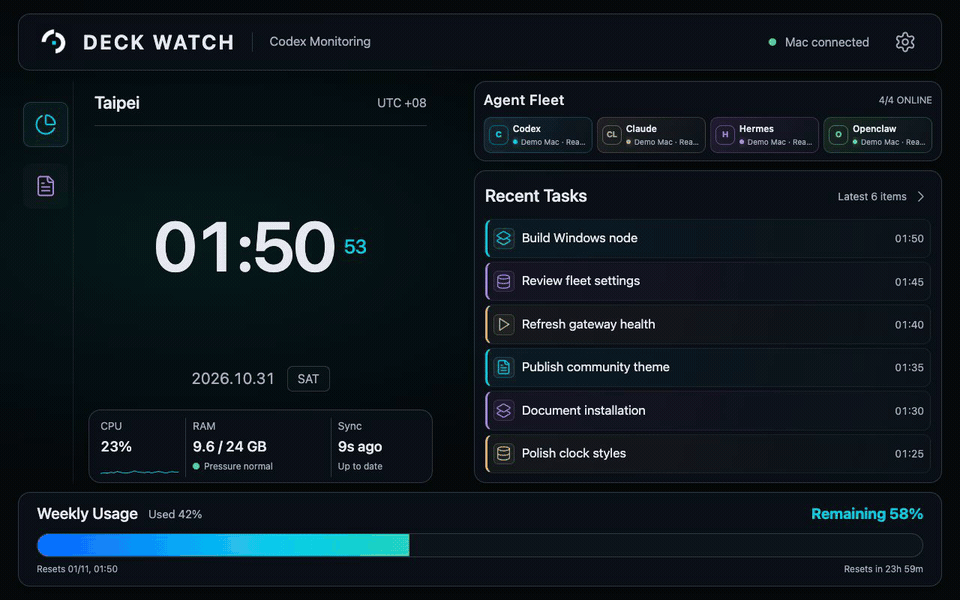

# Deck Watch


A private-LAN, Steam Deck-friendly dashboard for the agents running on your own computers. It is a deliberately read-only monitor: agent prompts, task output, credentials, transcripts and file paths never leave the machine that owns them.


Deck Watch has no runtime Python dependencies beyond Python 3.10+ and does not call an LLM to collect status.



_Demo data only — no real hosts, tasks, usage, or credentials are shown._


## What it monitors


| Runtime | Read-only signal | Notes |
| --- | --- | --- |
| Codex | Rate-limit windows and recent thread names | Uses the local Codex app-server allowlist. |
| Claude Code | Installation, sign-in state and CLI process presence | Never sends a prompt just to populate the dashboard. |
| Hermes Agent | Local dashboard health and active-session count | Opt in by adding its local /api/status URL. |
| OpenClaw | Gateway health and active-session summary | Uses openclaw health --json. |


working is shown only when the source reports active work or a local process is present. Recent Codex tasks remain historical updates, not a claim that a task is currently running or finished.


## Architecture


```text
Mac Node ──────┐
                ├── Deck Watch hub ── paired Steam Deck app
Windows Node ──┘
```


Every computer runs the same server.py. A hub can pull the compact status of up to 12 trusted LAN nodes with one per-node shared secret. The Steam Deck pairs only with the hub. Node keys and pairing keys are stored outside Git in .runtime/ or environment variables.


## Quick start: one computer


```sh
git clone https://github.com/YOUR_ACCOUNT/deckwatch.git
cd deckwatch
cp config/agents.example.json config/agents.json
python3 server.py --bind 127.0.0.1
```


Change host.label and remove the example nodes section unless this machine is acting as a hub. For LAN access, bind to that machine's private IPv4 address instead of 127.0.0.1. Visit the displayed address, then enter the generated eight-digit pairing code from .runtime/pairing.json locally.


## Add a Windows Codex node


On Windows, install and sign into Codex, clone this repository, then run the same server with Python 3.10+:


```powershell
$env:DECK_WATCH_NODE_KEY = "use-a-long-random-secret"
py server.py --bind 0.0.0.0 --config config/agents.json
```


On the hub, add a node entry to config/agents.json and pass the same secret only through an environment variable:


```json
{
  "nodes": [{
    "id": "windows-workstation",
    "label": "Windows Workstation",
    "endpoint": "http://192.168.50.200:8765",
    "keyEnv": "DECK_WATCH_WINDOWS_NODE_KEY"
  }]
}
```


Set DECK_WATCH_WINDOWS_NODE_KEY on the hub before it starts. The node endpoint accepts only private numeric LAN addresses and requires X-Deck-Watch-Node-Key; it returns bounded agent/host status only. Do not expose port 8765 or any agent dashboard to the public internet.
