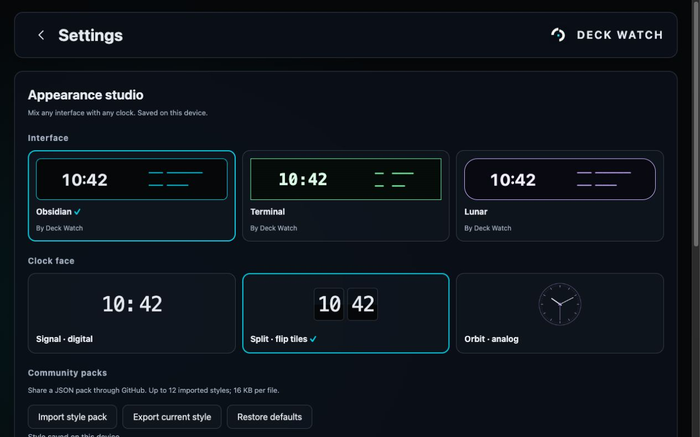

# Community style packs



Open Settings → Appearance studio. Choose an interface and a clock independently:

| Interface | Character |
| --- | --- |
| Obsidian | Near-black smoked glass, cyan accents |
| Terminal | Green phosphor palette, square panels, monospace type |
| Lunar | Violet highlights, rounded instruments, soft surfaces |

Clocks: Signal (digital), Split (split tiles), Orbit (analog). All use the same
Taipei time source as the dashboard. Reduced-motion preferences are respected.

## Import and share

1. Download a JSON pack from a creator.
2. Choose Import style pack in Settings. Review its preview, then Apply & save.
3. Export current style downloads JSON or lets you copy it, including the selected clock.
4. Share the JSON in a GitHub issue or submit a pull request under `themes/`.

This is a local import/export library, not a hosted marketplace. Settings and up to
12 imported packs are saved on the current device. Importing the same author/name
replaces that entry. Restore defaults keeps the library; Remove imported styles
clears the library and restores the default interface.

## Format v1

```json
{
  "version": 1,
  "name": "Amber Terminal",
  "author": "Community",
  "layout": "terminal",
  "clock": "flip",
  "palette": {
    "background": "#100b05",
    "surface": "#1a1209",
    "text": "#fff1d6",
    "muted": "#ccb898",
    "accent": "#ffc46b"
  }
}
```

Maximum size: 16 KB. Layout must be `glass`, `terminal`, or `lunar`; clock must be
`digital`, `flip`, or `analog`. Name/author are plain text up to 60 characters.
All five colors are required six-digit hex values. Text, muted text and accent
must each have at least 4.5:1 contrast against both background and surface.
Unknown fields are rejected.

Version 1 supports community palettes and combinations of the built-in renderers.
It does not load arbitrary clock code, CSS, fonts, images or remote URLs.
To propose a new clock renderer, contribute source through a reviewed pull request.
Use the repository MIT license for contributed packs and include no personal data.
